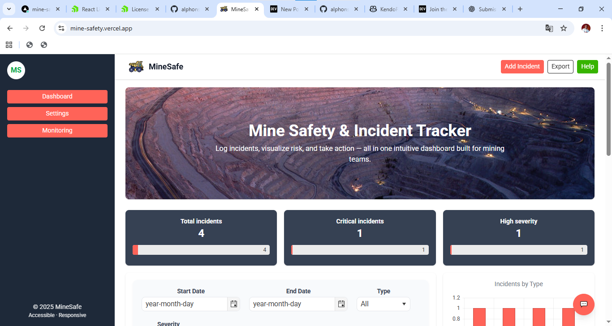

# Mine Safety & Incident Tracker Dashboard

Mining operations in the DRC (Democratic Republic of Congo) face frequent safety challenges. **MineSafety** provides a digital platform for workers and managers to quickly log incidents, monitor risks, and visualize safety data—helping make mines safer, more transparent, and more responsive.

## Problem Solved

Mining sites in the DRC often lack a streamlined, user-friendly system for reporting and analyzing safety incidents. Workers and supervisors need a fast, accessible way to:
- Log new incidents
- Track safety trends
- Identify high-risk zones
- Make data-driven decisions to improve workplace safety

## Core Features

- **Incident Submission Form:** Log incidents with details like location, type, severity, and date.
- **Real-Time Dashboard:** Visualize incidents in real time using KendoReact’s Grid, Charts (bar, pie), DatePicker, and DropDownList.
- **Persistent Data:** Incidents and settings are saved in localStorage for a seamless experience.
- **Theme & Language Switcher:** Instantly switch between light/dark mode and multiple languages (i18n support).
- **Responsive Navigation:** Modern Navbar, Sidebar, and hamburger menu for mobile/desktop.
- **Worker-Friendly Chatbot Assistant:** Use natural language commands such as:
  - "Log a new incident"
  - "Show me incidents by severity"
  - "Change theme to dark"
  - "Show statistics for today"
  - "Export incidents"
  - "Filter by location: Main Shaft"
- **Chatbot App Actions:** The assistant can trigger theme/language changes, open dialogs, filter, show stats, and more.
- **Comprehensive UI Components:** Built with KendoReact, including Grid, Charts, Inputs, Dialog, DropDownList, DatePicker, TabStrip, Notification, Avatar, and more.

## Tech Stack

- **Frontend:** React + TypeScript + Vite
- **UI Library:** [KendoReact](https://www.telerik.com/kendo-react-ui/) (Grid, Charts, Inputs, etc.)
- **Styling:** [TailwindCSS](https://tailwindcss.com/) for rapid, responsive UI design
- **State & Data:** Modern React state management and hooks
- **Chatbot:** Custom worker assistant for conversational incident management

## 📁 Project Structure

```
MineSafety/
├── index.html
├── package.json
├── README.md
├── tsconfig.app.json
├── tsconfig.json
├── tsconfig.node.json
├── vite.config.ts
├── public/
│   └── vite.svg
├── src/
│   ├── App.tsx
│   ├── i18n.tsx
│   ├── index.css
│   ├── main.tsx
│   ├── assets/
│   │   ├── classroom.svg
│   │   ├── design.svg
│   │   ├── documentation.svg
│   │   ├── hero-bg.jpg
│   │   ├── license.svg
│   │   ├── logo.svg
│   │   ├── react.svg
│   ├── components/
│   │   ├── ChatPanel.tsx
│   │   ├── Hero.tsx
│   │   ├── IncidentForm.tsx
│   │   ├── IncidentGrid.tsx
│   │   ├── Navbar.tsx
│   │   ├── Sidebar.tsx
│   │   ├── StatsCard.tsx
│   ├── data/
│   │   └── incidents.ts
│   ├── pages/
│   │   ├── Dashboard.tsx
│   │   ├── Monitoring.tsx
│   │   └── Settings.tsx
```

- **src/assets/**: Images, SVGs, and static media assets
- **src/components/**: Reusable React components:
  - `Navbar.tsx`, `Sidebar.tsx`: Responsive navigation and layout
  - `IncidentForm.tsx`: Incident submission form
  - `IncidentGrid.tsx`: Data grid for incidents
  - `StatsCard.tsx`: Dashboard statistics
  - `ChatPanel.tsx`: Conversational assistant/chatbot (can trigger app actions, show stats, filter, etc.)
  - `Hero.tsx`: Landing/hero section
- **src/data/**: Incident data (mock or persistent)
- **src/pages/**: Page-level components (e.g., `Dashboard.tsx`, `Monitoring.tsx`, `Settings.tsx`)
- **src/App.tsx**: Main application component, handles layout, theme, language, and state
- **src/main.tsx**: Vite entry point
- **src/index.css**: TailwindCSS and global styles
- **src/i18n.tsx**: Internationalization (i18n) context/provider

## Getting Started

1. **Install dependencies:**
   ```bash
   npm install
   ```
2. **Start the development server:**
   ```bash
   npm run dev
   ```
3. **Visit:** [http://localhost:5173](http://localhost:5173)

## Usage

- Log in as a worker or supervisor.
- Use the chatbot or the incident form to submit new reports.
- Explore incidents by date, severity, type, or location in the dashboard.
- Review the heatmap to identify and address high-risk zones.

## Available Scripts

- `npm run dev` – Start Vite development server
- `npm run build` – Build for production
- `npm run lint` – Run ESLint checks

## Contributing

Pull requests are welcome! For major changes, please open an issue first to discuss what you’d like to change.

## License

MIT

---

*Empowering safer mining through digital transparency and real-time data.*
